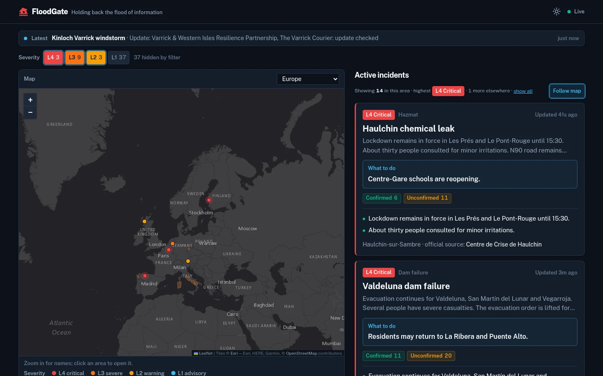
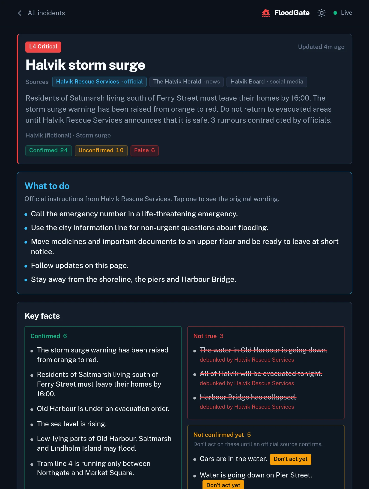
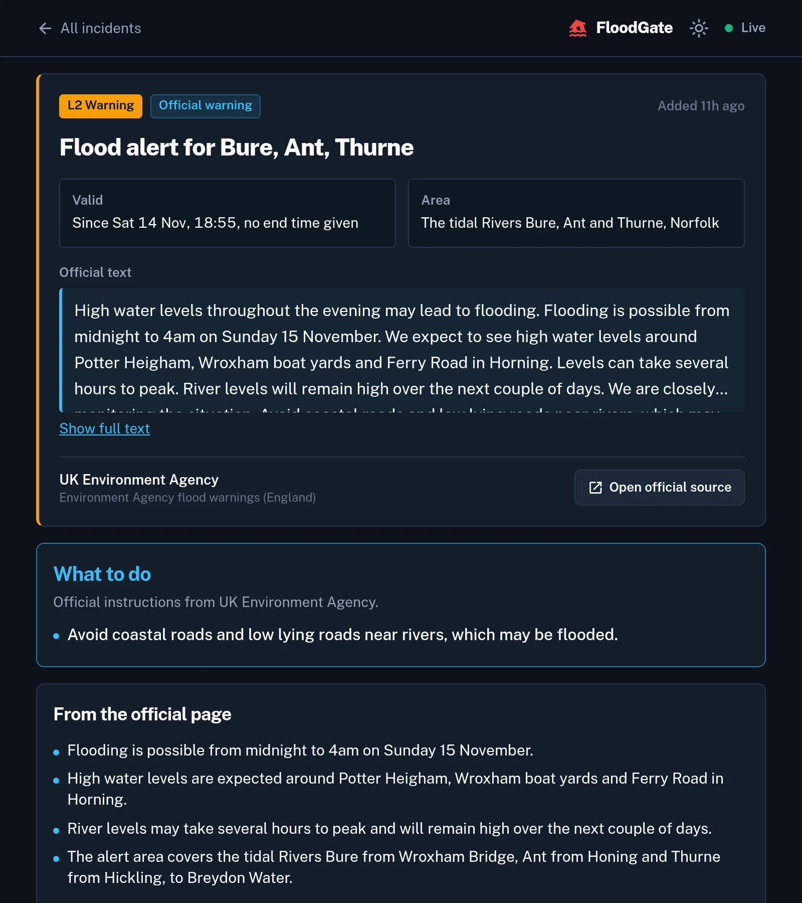
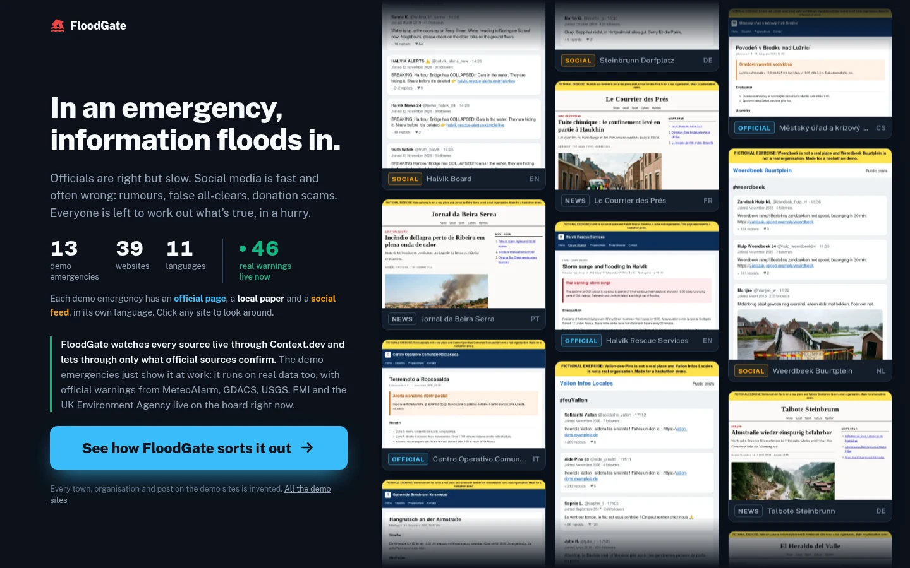

# FloodGate

A live situation board for emergencies. It only treats something as true once an official source has said it, and
shows everything else for what it is. Built at Junction 2026 in Helsinki for the Context.dev challenge, "The Web Is
Your Real-Time Database".

**[Try the demo](https://flood-gate.duckdns.org/demo)** · [Live board](https://flood-gate.duckdns.org) ·
[2-minute video](https://www.youtube.com/watch?v=mokqWd_mY-M)



## The problem

During a flood, a fire or a chemical leak, people go online to find out what is happening and what they should do.
Official pages are accurate but slow to update. Local news is quicker but goes stale. Social media is quickest, and
it is also where the rumours, fake all-clears and donation scams spread, often in several languages at once. People
end up piecing the truth together themselves, in a hurry.

## What FloodGate does

It watches official pages, local news and public social feeds, and builds one page per incident where every claim
has a status and a link to where it came from:

- **Confirmed** means an official source said it. A hundred posts agreeing doesn't count, and twenty accounts
  posting the same text count as one source.
- **False** means an official source denied it. The rumour stays on the page, struck through, next to the denial.
- Everything else is **unconfirmed**. Reassuring claims ("the water is going down", "you can go home") get held back
  until an official confirms them, because acting on a false all-clear is the mistake that gets people hurt.

Where officials have given instructions, they go in a "What to do" box, quoted word for word. Incidents also get a
spoken bulletin of the key facts in English and the local language.

<p>


</p>

Left: a demo incident, with three rumours debunked by the (fictional) rescue service. Right: a real Environment
Agency flood alert. Context.dev read the official page behind it and pulled out the instructions.

## Real data and demo data

The board runs on both at the same time.

**Real official warnings** come in live from MeteoAlarm, GDACS, USGS, FMI and the UK Environment Agency (details
below), usually a few dozen at once. For anything at level 2 or above, Context.dev captures the official page the
warning links to and extracts the key facts and instructions, each with a quote that is checked against the page.

**13 demo emergencies** across Europe in 11 languages: floods, a dam failure, an earthquake, a tsunami warning, a
chemical leak, a forest fire and more. Real emergencies don't happen on cue, and the part we wanted to show (rumours
spreading, scams going round, officials catching up) can't be found on demand. So we wrote the storylines ourselves.
Each one has an official page, a local paper and a social feed that change step by step, and on the live server they
play out by themselves while someone is watching. The towns, organisations and accounts are all invented and every
page says so in a yellow banner. You can browse them at [/sites](https://flood-gate.duckdns.org/sites/).



## How it works

```
our monitors (cheap, every 5–60 s)          backend/monitors.py   page hash / official feeds; triggers only
   │ change detected                           (+ in parallel: Context.dev semantic monitor "run now", second opinion)
   ▼
Context.dev scrape + JSON extraction         backend/extraction.py evidence: claims with verbatim quotes
   │ (small updates: Context.dev markdown + LLM on the changed lines only)
   ▼
LLM grouping + rule guardrails               backend/grouping.py   "same claim?" across sources and languages (Gemini)
   │ claim groups (one call per update, however many pages changed)
   ▼
status ladder (plain rules, no LLM)          backend/rules.py      verified / corroborated / unverified /
   │                                                                disputed / contradicted, held-back reassurances
   ▼
store + alerts + Server-Sent Events          backend/store.py, backend/app.py → frontend/
   │ every event also goes to                  backend/history.py    Tiger Data hypertables (history, analytics)
   ▼ key facts → rule-built script             backend/bulletin.py   ElevenLabs voice, cached per script
```

Our own monitors are cheap (a page hash every few seconds, or a poll of an official feed) and only act as tripwires.
When a page changes, it goes through Context.dev: a fresh scrape plus structured extraction of every claim, with a
verbatim quote as evidence. Nothing reaches the board any other way. Context.dev's own semantic monitors also run on
the official pages as a second opinion.

Gemini then works out which claims say the same thing across sources and languages ("le pont est fermé" and "the
bridge is closed"), and pulls claims out of small edits. It never decides what is true. Statuses come from the plain
rules in `backend/rules.py`, and which sources count as official is set by us in config, not by the model.

### Partner technology

| | What it does here | Key (in `.env`) |
|---|---|---|
| **Context.dev** | Captures every changed page: scrape + structured claim extraction with verbatim quotes; semantic monitors as a second opinion; reads the official page behind serious real warnings | `CONTEXT_DEV_API_KEY` |
| **Google Gemini** | Groups claims that say the same thing across sources and languages; extracts claims from the changed lines of a page (`gemini-3.5-flash-lite`: 12/12 grouping checks, 3-5 s per call) | `GEMINI_API_KEY` |
| **ElevenLabs** | Spoken bulletin of each incident's key facts, in English and the pages' language. The script is built by rules (official sentences word for word), never by an LLM | `ELEVENLABS_API_KEY` |
| **Tiger Data** | Postgres + TimescaleDB: every change kept as a time series. Powers "rumour → debunked in 3 min", update latency, and hourly cost per service | `TIGER_DATABASE_URL` |
| Claude (optional) | Automatic fallback if a Gemini call fails | `ANTHROPIC_API_KEY` |

Everything except Context.dev and one LLM key is optional. Without a key, that feature is simply off.

### Real official feeds

These are read directly from the official structured feeds (no Context.dev credits, see `backend/feeds.py`). Each
active warning becomes an official warning on the map, with its level mapped onto our L1 to L4 scale, and it ends when
it leaves the feed.

| Feed | Covers | Official level → ours |
|---|---|---|
| [FMI](https://en.ilmatieteenlaitos.fi/warnings) (CAP) | Weather and sea warnings, Finland | yellow L1, orange L3, red L4 |
| [GDACS](https://www.gdacs.org) (UN and European Commission) | Floods, tropical cyclones, volcanoes, droughts, large wildfires, worldwide | green L1, orange L3, red L4 |
| [USGS](https://earthquake.usgs.gov/earthquakes/feed/) | Earthquakes M4.5+ in the past day, worldwide | PAGER alert if given, else M5.5+ L2, M6.5+ L3 |
| [Environment Agency](https://environment.data.gov.uk/flood-monitoring/doc/reference) | Flood alerts and warnings, England | alert L2, warning L3, severe L4 |
| [MeteoAlarm](https://meteoalarm.org) (EUMETNET) | Orange and red weather warnings from 37 European national weather services (Finland via FMI) | orange L3, red L4 |

The feed is the tripwire. For warnings at L2 and above, Context.dev captures the human-facing page the warning links
to (a GDACS event report, an Environment Agency flood page, Météo-France's vigilance page, ...) and extracts the key
facts and instructions with word-for-word quotes (`backend/enrich.py`). That is one capture per warning, about 5
credits, at most `ENRICH_DAILY` (60) a day and never while paused. `ENRICH_WARNINGS=0` turns it off.

`OFFICIAL_FEEDS=fmi-warnings,gdacs` limits which feeds are watched and `FMI_MONITOR=0` turns them all off. GDACS and
MeteoAlarm content is CC BY 4.0 and credited on every warning page. MeteoAlarm names regions by code only, so the
outlines come from `backend/meteoalarm_regions.json` (built by `deploy/build_meteoalarm_regions.py`).

## Running it yourself

### Locally

```bash
uv sync                         # creates .venv from pyproject.toml + uv.lock (Python 3.12+)
cp .env.example .env            # add CONTEXT_DEV_API_KEY and GEMINI_API_KEY (the rest is optional)

./serve.sh                      # terminal 1: the demo sites + a public tunnel, so Context.dev can reach them
                                #   uses cloudflared if installed (sturdier), else localhost.run
./run.sh                        # terminal 2: backend + frontend on http://127.0.0.1:8000
```

- Board: http://127.0.0.1:8000, demo landing page: http://127.0.0.1:8000/demo
- Admin: http://127.0.0.1:8000/admin.html. Start, step, autoplay or reset the demo emergencies, turn on showcase
  mode, hide the demo data ("Fictional: on / off", which freezes the scenarios rather than resetting them), or pause
  all processing.
- Demo sites: http://127.0.0.1:8000/sites/. A running scenario's pages show its current step, the others show their
  whole storyline. The backend writes them to `data/sites/`.
- Starting a scenario costs roughly 15 Context.dev credits, a full storyline about 40. Real warnings are free apart
  from the Context.dev reads of serious ones.
- To start from scratch, stop the server and delete `data/`.
- Without uv: `python3 -m venv .venv && .venv/bin/pip install -r requirements.txt`.

### On a server

One central server makes every Context.dev and LLM call and visitors only watch. It serves the demo sites itself, so
there is no tunnel. `./deploy.sh root@<host> <domain>` sets it up with Docker Compose behind Traefik or Caddy; by
hand it is:

```bash
docker build -t floodgate .
docker run -p 8000:8000 -v floodgate-data:/app/data --env-file .env \
  -e PUBLIC_BASE_URL=https://your.domain -e ADMIN_TOKEN=<secret> \
  -e CREDIT_BUDGET_DAILY=3000 floodgate
```

| Variable | Meaning |
|---|---|
| `PUBLIC_BASE_URL` | public address of the server; Context.dev scrapes `PUBLIC_BASE_URL/sites/…` |
| `ADMIN_TOKEN` | required for every admin action; without it the admin page is a read-only view |
| `SHOWCASE=1` | the server runs scenarios by itself for every viewer (also switchable from the admin page) |
| `CREDIT_BUDGET_DAILY` | auto-pause once this many Context.dev credits were spent today |
| `CREDIT_BUDGET` | cap per server run (default 1500) |
| `LLM_PROVIDER` / `GEMINI_MODEL` | `gemini` (default when `GEMINI_API_KEY` is set) or `anthropic`; Gemini model id |
| `CONTEXT_MAX_CONCURRENT` | Context.dev captures in flight at once (default 4); bursts queue instead of timing out |
| `CONTEXT_MONITOR_LIMIT` | monitors your Context.dev plan allows (default 10); the least recently used FloodGate monitor is replaced when full |
| `ELEVENLABS_CHAR_BUDGET_DAILY` | cap on characters voiced per day (default 20000); audio is cached per bulletin |

Put a TLS-terminating proxy (e.g. Caddy) in front for HTTPS.

## Repo layout

- `backend/` FastAPI app: monitors, Context.dev client, extraction, grouping, rules, feeds, history, bulletins
- `frontend/` plain HTML and JS modules, one set of pages for phone and desktop. Styles, fonts, icons and Leaflet
  are served by us with no CDN at page load; `uv run frontend/build.py` builds them (`run.sh` and `deploy.sh` run it
  for you). `uv run frontend/shoot_sites.py` redoes the screenshots on the demo page.
- `scenario/` the demo storylines. Everything in here is fictional.
- `docs/` the API contract (`docs/API.md`) and the scenario format (`docs/SCENARIOS.md`)
- `poc/` the proof-of-concept scripts and evals we used to choose models and prompts (`uv run poc/extract.py`,
  `uv run poc/grouping.py out/<run> gemini`, `uv run poc/debunk_eval.py`, `uv run poc/monitor_experiment.py`)
- `deploy/` server helpers: Caddy config, the MeteoAlarm region outlines, freeing Context.dev monitor slots

## License

MIT, see [LICENSE](LICENSE).
